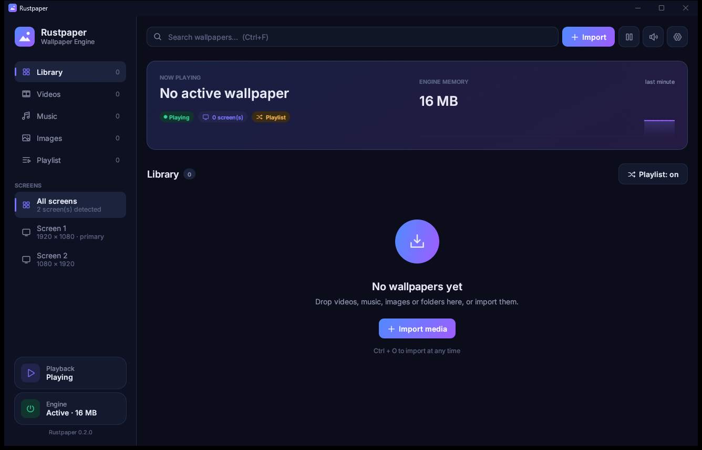

<div align="center">


# Rustpaper

**A blazing-fast, open-source animated wallpaper engine written in Rust.**

Turn any video, song or image into your desktop wallpaper — on Windows 10/11 and Linux.

[](https://github.com/fromhumantohorse/rustpaper/releases/latest)
[](LICENSE)


[**Download**](https://github.com/fromhumantohorse/rustpaper/releases/latest) · [Features](#-features) · [Build](#-building-from-source) · [Architecture](#-architecture)



</div>

---

## ✨ Features

|  | |
|---|---|
| 🎬 **Any media** | MP4, MKV, WebM, AVI, MOV, WMV, GIF · MP3, FLAC, WAV, OGG, Opus, M4A, AAC (with a live audio visualizer) · PNG, JPG, BMP, WebP |
| 🖱️ **Drag & drop** | Drop files — or whole folders — onto the window. Thumbnails are generated automatically. |
| 🖥️ **Multi-monitor** | One wallpaper per screen or the same everywhere. Hot-plugging is handled. |
| 🎛️ **Per-wallpaper tuning** | Volume, speed, loop, fill / fit / stretch / center, brightness, contrast, saturation, gamma |
| ⚡ **Ultra-light** | Videos are automatically re-encoded once to each screen's exact resolution: a 4K wallpaper on two monitors uses **~3 % GPU, ~115 MB VRAM and ~0.6 % CPU**. FPS limiter, render-quality presets, tiny demuxer cache; the engine idles at **~15 MB of RAM** when paused. |
| 🔋 **Smart pausing** | Pause or mute when an app is focused, maximized or fullscreen — **per monitor** — or when running on battery. Memory is released while paused. |
| 🔀 **Playlists** | Sequential or shuffled rotation with a custom interval |
| 🔔 **System integration** | Notification-area icon, launch at startup, single instance, theme-colored title bar |
| 🌍 **7 languages** | English, Français, Español, Русский, العربية, 中文, हिन्दी |

<div align="center">


</div>

## 📦 Installation

### Windows 10 / 11

**Installer (recommended):** download `Rustpaper-<version>-windows-x64.msi` from the [latest release](https://github.com/fromhumantohorse/rustpaper/releases/latest) and run it.
It installs to `Program Files`, adds **Desktop** and **Start menu** shortcuts, and upgrades previous versions in place. Uninstall from *Settings → Apps*.

**Portable:** download `Rustpaper-<version>-windows-x64.zip`, extract it anywhere (keep the files together) and run **`rustpaper-studio.exe`** — the engine starts automatically.

### Linux (X11)

Install `libmpv` (`sudo apt install libmpv2` / `sudo pacman -S mpv`) and [build from source](#-building-from-source).
Wayland sessions work through XWayland with compositors that honor `_NET_WM_WINDOW_TYPE_DESKTOP`.

## ⌨️ Shortcuts

| Shortcut | Action |
|---|---|
| `Ctrl` + `O` | Import media |
| `Ctrl` + `F` | Search the library |
| `Esc` | Close the side panel / settings |

## 🏗️ Architecture

Rustpaper follows **Domain-Driven Design** with a **hexagonal architecture**, and the UI is built with **Atomic Design**.

```
crates/
  domain/          pure business rules — Library, Wallpaper, PlaybackRules, bounded value objects
  application/     use cases & ports — LibraryCommands, WallpaperEngine
  infrastructure/  adapters — JSON storage, libmpv, Win32 (WorkerW, DWM, tray), X11, IPC
  i18n/            type-safe translations (a missing string is a compile error)
apps/
  daemon/          rustpaper-daemon — headless engine that renders behind your desktop icons
  studio/          rustpaper-studio — egui interface
                   ui/{theme, atoms, molecules, organisms, templates}
```

The **Studio** edits `library.json` (atomic, fsync'd writes) and notifies the **engine** over an authenticated local channel: ephemeral `127.0.0.1` port + random 128-bit token stored in the user profile, with a file lock guaranteeing a single instance per session.

Rendering is done by [libmpv](https://mpv.io) — GPU decoding and FFmpeg filters with a minimal footprint.

## 🔧 Building from source

Requirements: Rust **1.89+** and `libmpv` development files.

```sh
sh scripts/generate-assets.sh   # icon + Inter font (once)
cargo test --workspace
cargo build --release
```

Cross-compiling for Windows from Linux (with the `mpv-dev-x86_64` package from
[shinchiro/mpv-winbuild-cmake](https://github.com/shinchiro/mpv-winbuild-cmake/releases) extracted into `.cache/mpv`):

```sh
RUSTFLAGS='-L .cache/mpv' cargo build --release --target x86_64-pc-windows-gnu
```

Place `rustpaper-studio.exe`, `rustpaper-daemon.exe` and `libmpv-2.dll` in the same folder,
or run `sh scripts/package-windows.sh` to produce the portable `.zip` and the `.msi` installer (requires `msitools`).

Logs live in `%LOCALAPPDATA%\Rustpaper\Rustpaper\cache\logs` (Windows) or `~/.cache/rustpaper/logs` (Linux).

## ⚠️ Known limitations

- Arabic text is shaped and written right-to-left, but the layout itself is not mirrored.
- Hindi is rendered without complex Devanagari shaping (egui has no text shaping), so some vowel signs appear after their consonant.
- No notification-area icon on Linux yet.

## 📄 License

The Rustpaper source code is released under the [MIT License](LICENSE).
Binary releases bundle third-party components under their own licenses — see [THIRD_PARTY_NOTICES.md](THIRD_PARTY_NOTICES.md).
