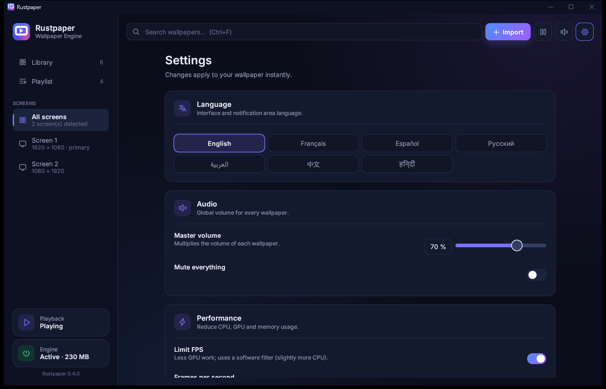
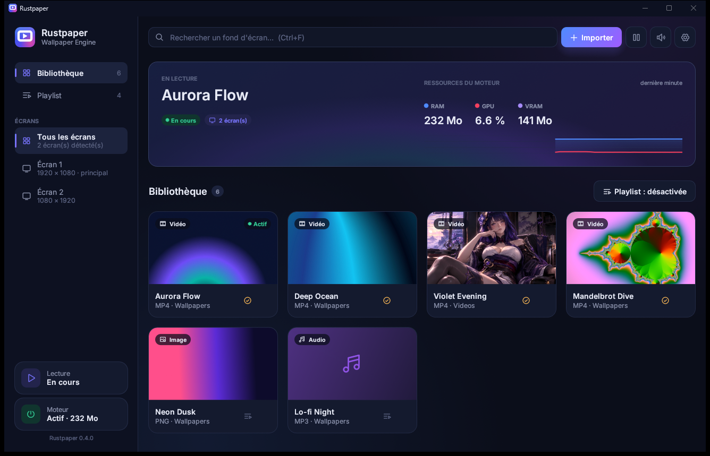

<div align="center">


# Rustpaper

**A blazing-fast, open-source animated wallpaper engine written in Rust.**

Turn any video, song or image into your desktop wallpaper — on Windows 10/11 and Linux.

[](https://github.com/fromhumantohorse/rustpaper/releases/latest)
[](https://github.com/fromhumantohorse/rustpaper/releases)
[](LICENSE)


[**Download**](https://github.com/fromhumantohorse/rustpaper/releases/latest) · [Features](#-features) · [Build](#-building-from-source) · [Architecture](#-architecture)


</div>

---

## ✨ Features

|  | |
|---|---|
| 🎬 **Any media** | MP4, MKV, WebM, AVI, MOV, WMV, GIF · MP3, FLAC, WAV, OGG, Opus, M4A, AAC (with a live audio visualizer) · PNG, JPG, BMP, WebP |
| 🖱️ **Drag & drop** | Drop files — or whole folders — onto the window. Thumbnails are generated automatically. |
| 🖥️ **Multi-monitor** | One wallpaper per screen or the same everywhere. Hot-plugging is handled. |
| 🎛️ **Per-wallpaper tuning** | Volume, speed, loop, fill / fit / stretch / center, brightness, contrast, saturation, gamma |
| ⚡ **Ultra-light** | Videos are automatically re-encoded once to each screen's exact resolution: a 4K wallpaper on two monitors uses **~3 % GPU, ~120 MB VRAM, ~170 MB RAM and < 0.5 % CPU**. Decoder threads are capped, so even a raw 4K file without hardware decoding needs half the memory of v0.3. |
| 📈 **Live monitoring** | RAM (blue) and GPU (red) charts for the last minute, plus VRAM — measured from Windows' own GPU counters. |
| 🔋 **Smart pausing** | Keep running, mute, pause or **stop** when an app is focused, maximized or fullscreen — **per monitor** — or on battery. *Stop* (default for fullscreen games) frees the player, its RAM and its VRAM entirely. |
| 🔀 **Playlists** | Sequential or shuffled rotation with a custom interval; upcoming items are optimized ahead of time. |
| 🔄 **Silent updates** | The installed app downloads new releases in the background, verifies their SHA-256 and installs them while the Studio is closed — no prompt, no admin rights. Can be turned off. |
| 🔔 **System integration** | Notification-area icon (open, settings, pause, mute, quit), launch at startup, single instance, theme-colored title bar |
| 🌍 **7 languages** | English, Français, Español, Русский, العربية, 中文, हिन्दी |

<div align="center">

<br>



</div>

## 🥊 Rustpaper vs Wallpaper Engine

| | Rustpaper | Wallpaper Engine |
|---|---|---|
| Price | **Free** | Paid |
| Source code | **Open (MIT)** | Closed |
| Linux | **Yes (X11)** | No |
| Account / Steam required | **No** | Yes |
| Telemetry | **None** — the only network request is the optional update check to GitHub | Steam client |
| Re-encodes videos to your screen size | **Yes, automatically** | No |
| Frees GPU memory under fullscreen games | **Yes (Stop policy)** | Pauses |
| Videos, music with visualizer, images | Yes | Yes |
| Scene / web / interactive wallpapers, Workshop | No | **Yes** |

Rustpaper focuses on doing video, audio and image wallpapers with the smallest possible footprint. If you need Workshop content or scene/web wallpapers, Wallpaper Engine remains the tool for that.

## 📦 Installation

### Windows 10 / 11

**Installer (recommended):** download `Rustpaper-<version>-windows-x64.msi` from the [latest release](https://github.com/fromhumantohorse/rustpaper/releases/latest) and run it.
It installs for the current user in `%LOCALAPPDATA%\Programs\Rustpaper` (**no administrator rights needed**), adds **Desktop** and **Start menu** shortcuts, and keeps itself up to date silently. Uninstall from *Settings → Apps*.

> Upgrading from **v0.3.0 or older** (installed in `Program Files`)? Uninstall it from *Settings → Apps* first — your library and settings are kept. From v0.4.0 on, updates are automatic.

**Portable:** download `Rustpaper-<version>-windows-x64.zip`, extract it anywhere (keep the files together) and run **`rustpaper-studio.exe`** — the engine starts automatically.

### Linux (X11)

Install `libmpv` (`sudo apt install libmpv2` / `sudo pacman -S mpv`) and [build from source](#-building-from-source).
Wayland sessions work through XWayland with compositors that honor `_NET_WM_WINDOW_TYPE_DESKTOP`.

## ⌨️ Shortcuts

| Shortcut | Action |
|---|---|
| `Ctrl` + `O` | Import media |
| `Ctrl` + `F` | Search the library |
| `Esc` | Close the side panel / settings |

## 🏗️ Architecture

Rustpaper follows **Domain-Driven Design** with a **hexagonal architecture**, and the UI is built with **Atomic Design**.

```
crates/
  domain/          pure business rules — Library, Wallpaper, PlaybackRules, bounded value objects
  application/     use cases & ports — LibraryCommands, WallpaperEngine
  infrastructure/  adapters — JSON storage, libmpv, Win32 (WorkerW, DWM, tray), X11, IPC
  i18n/            type-safe translations (a missing string is a compile error)
apps/
  daemon/          rustpaper-daemon — headless engine that renders behind your desktop icons
  studio/          rustpaper-studio — egui interface
                   ui/{theme, atoms, molecules, organisms, templates}
  updater/         rustpaper-updater — tiny helper that installs a verified update once the engine has exited
```

The **Studio** edits `library.json` (atomic, fsync'd writes) and notifies the **engine** over an authenticated local channel: ephemeral `127.0.0.1` port + random 128-bit token stored in the user profile, with a file lock guaranteeing a single instance per session.

Rendering is done by [libmpv](https://mpv.io) — GPU decoding and FFmpeg filters with a minimal footprint.

Updates come only from this repository's GitHub releases over HTTPS: the download URL must belong to the repository, the installer is checked against the published SHA-256 before it runs, and a failed install is never retried in a loop.

## 🔧 Building from source

Requirements: Rust **1.89+** and `libmpv` development files.

```sh
sh scripts/generate-assets.sh   # icon + Inter font (once)
cargo test --workspace
cargo build --release
```

Cross-compiling for Windows from Linux (with the `mpv-dev-x86_64` package from
[shinchiro/mpv-winbuild-cmake](https://github.com/shinchiro/mpv-winbuild-cmake/releases) extracted into `.cache/mpv`):

```sh
RUSTFLAGS='-L .cache/mpv' cargo build --release --target x86_64-pc-windows-gnu
```

Place `rustpaper-studio.exe`, `rustpaper-daemon.exe`, `rustpaper-updater.exe` and `libmpv-2.dll` in the same folder,
or run `sh scripts/package-windows.sh` to produce the portable `.zip` and the `.msi` installer (requires `msitools`).

Logs live in `%LOCALAPPDATA%\Rustpaper\Rustpaper\cache\logs` (Windows) or `~/.cache/rustpaper/logs` (Linux).

## ⚠️ Known limitations

- Arabic text is shaped and written right-to-left, but the layout itself is not mirrored.
- Hindi is rendered without complex Devanagari shaping (egui has no text shaping), so some vowel signs appear after their consonant.
- No notification-area icon on Linux yet.

## 📄 License

The Rustpaper source code is released under the [MIT License](LICENSE).
Binary releases bundle third-party components under their own licenses — see [THIRD_PARTY_NOTICES.md](THIRD_PARTY_NOTICES.md).
